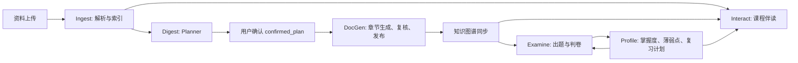

# AITeachMe 项目审查记录（2026-10-20）

审查基线：`84c40281`，本地 Windows、conda `atm`；线上入口为 `https://aiteachme.cn`。

## 1. 结论与改动范围

现有五大引擎的划分能够承接产品的学习闭环，暂未发现足以支持整体重写的证据。本轮优先处理能够复现的安全问题，并区分业务代码缺陷、模型服务故障与尚未完成的验证。

| 优先级 | 发现 | 本轮处理 |
| --- | --- | --- |
| 高 | 公网网页 reader 只检查 URL 字面的 IP，域名解析到内网时仍可访问 | 已在本地修复，补充核心安全回归；未部署线上 |
| 高 | 当前真实建课调用出现模型连接/读取超时，默认路径返回 502、504，讲义审核也受阻 | 已复现；显式 `reason` 规划成功，随后 DocGen 因两次审核连接超时无法发布，仍需治理上游可靠性 |
| 中 | 历史 LangSmith 中存在 DocGen 发布校验失败、空流回复、503、超时 | 保留证据；旧记录与当前版本分开判断，不据此盲目修改题量或渲染规则 |
| 后续整理 | 部分架构文档与实现有偏差，考试 API 承担较多业务编排 | 记录具体位置，未做大规模文件搬迁 |

**本报告不能作为“线上线下所有功能和性能全部正常”的证明。** 自动回归、基础可用性与真实模型链路是不同层次的证据；生产版本也未通过部署标识与本地提交逐一核对。

## 2. 对当前实现的理解

### 2.1 分层和隔离边界

前端是 React/TypeScript，通过 Orval 生成的客户端访问 FastAPI。后端的目标依赖方向为：

```text
api / schemas
  -> workflows（业务用例和流程）
  -> repositories / shared.infra / models
  -> SQLite 或 PostgreSQL + ContentStore
```

`Course` 是教学资料、讲义、知识图谱、考试和掌握度的主要业务边界，用户身份决定资源访问权限。`support/` 承接身份、课程、导入导出和系统配置等支撑业务。并非每个 API 用例都需要 LangGraph；已有 lane 的状态、节点和内部辅助职责应继续保留。

### 2.2 五大引擎如何串联



| 引擎 | 实际主要入口 | 已有实现与关注点 |
| --- | --- | --- |
| Ingest | `ingest/intake`、`ingest/parsing` | 上传建档、快速解析、可选深度增强、检索索引；解析状态和索引状态需要分别观察 |
| Digest | `digest/planner`、`digest/docgen`、`digest/kg_doc_sync` | 先规划并确认，再按冻结合同构建；章节并行、复核修补、正式发布与图谱同步有独立生命周期 |
| Interact | `interact/chat` | 组合课程资料、检索结果、划选上下文、错题和画像，选择教学策略并流式输出，最后持久化会话 |
| Examine | `examine/question_build`、`examine/exam_grade` | 由知识点与掌握度生成试题，支持客观规则判分与主观模型判分；判卷和画像同步需要分别检查终态 |
| Profile | `profile/update`、`profile/snapshot`、`profile/study_plan` | 用历史答题和本次表现更新掌握度、置信度、稳定性、复习任务及汇总；当前实现属于统计量化，不能等同于已实现 BKT 遗忘预测 |

重要的正确设计包括：正式构建绑定 `confirmed_plan`、草稿与正式发布分离、DocGen 与图谱状态分离、判卷后画像同步可以追踪和重试。同一用户的画像更新已有 PostgreSQL 事务锁及 SQLite 写事务边界；不应为了表面简化移除这些约束。

### 2.3 Infra 的关键职责

| 能力 | 目录/入口 | 审查判断 |
| --- | --- | --- |
| 模型调用 | `shared/infra/llm_support` | LiteLLM、Chat/Responses 适配、流式读取、重试/备用端点、并发调度和观测集中管理；业务预算放在 lane 的 `model_policy.py`，这个边界应保留 |
| 检索与网页读取 | `shared/infra/search` | 本地资料检索与外部来源读取是能力层；教学意图和写作策略应留在 workflow；本轮修复位于这里 |
| 向量能力 | `shared/infra/embedding`、search 索引 | 本地 SQLite/sqlite-vec 与云端 PostgreSQL/pgvector 有环境差异，本地通过不能替代云端数据库验证 |
| 内容存储 | `shared/infra/storage` | 数据库保存业务状态，ContentStore 保存原始资料、Markdown 和资产；私有文件应经后端鉴权读取，不应直接暴露对象存储地址 |
| 运行与观测 | `shared/infra/runtime`、`workflow`、`observability` | 后台任务、生命周期、进度和追踪是定位长流程问题的重要依据；健康接口成功不能代表模型可用 |

## 3. 高优先级发现

### 3.1 网页读取可通过域名解析访问内网（已修复）

位置：`backend/app/shared/infra/search/readers/common.py`。

原 `_validate_public_fetch_url()` 会拒绝 `127.0.0.1` 等字面 IP，却直接放行普通域名。HTTP 客户端随后自行解析域名，因此域名指向内网时仍能发起请求；只在发送请求前查询一次 DNS、随后继续按域名连接，也不能防住地址在两次解析间变化。

本次在本地启动一次性 HTTP 服务，仅将测试域名的 DNS 映射到 loopback，旧实现确实读取到了本地服务返回的 `private`。没有对生产执行内网探测。修复后，同一复现被 `non-public IP addresses` 拒绝。

修复措施：

- 使用 HTTPX 的 URL 解析结果统一校验，拒绝非 HTTP(S)、localhost、非公网字面地址以及 URL 内嵌凭证。
- 异步解析 DNS，校验全部返回地址；公网/私网混合解析也拒绝。
- 直接连接校验后的 IP，同时保留原始 HTTP Host、TLS SNI 和证书校验，避免二次域名解析。
- 每次重定向重新校验；跨 origin 移除 Authorization；不继承环境代理、隐式认证及前一跳网页 Cookie。
- 每跳独立连接池，避免不同主机共用 IP 时复用前一主机的 TLS 连接。
- 连接失败时可尝试其他已校验的公网地址；返回对象仍暴露原始逻辑 URL，保持 reader 调用语义。

新增 `backend/tests/test_reader_fetch_security.py` 的 20 个核心安全用例，覆盖私网地址、混合 DNS、IP 固定、Host/SNI、重定向、凭证隔离及备用地址。这是共享安全边界，适合建立稳定回归；没有为普通展示或低影响逻辑扩充测试。

正常公网 HTTPS `https://example.com/`、`https://aiteachme.cn/` 的读取也已实测成功，未关闭证书校验。

### 3.2 模型链路可靠性仍会阻断建课（尚未解决）

测试使用隔离的数据目录和一次函数 Markdown，没有修改用户原有课程或资料。

| 阶段 | 模型选择 | 实测结果 |
| --- | --- | --- |
| 创建前置诊断，第一次 | 配置默认值，实际调用 `gpt-6-luna` | 约 131.5 秒后 502，流式读取超时 |
| 创建前置诊断，第二次 | 显式 `reason`，实际调用 `gpt-6-sol` | 约 88.9 秒后 200，期间有连接超时重试 |
| 跳过诊断、生成方案，第一次 | 请求未带 model，使用配置默认值 | 约 180.1 秒后 504，耗尽整体调用预算 |
| 同一会话再次生成方案 | 显式 `reason` | 约 53.1 秒后 200，首次连接约 10.9 秒超时，第二次调用成功 |

模型覆盖是每请求行为，消息接口本身也提供 `model` 字段；本次未传该字段的请求不能算作 `reason` 模型失败。显式 `reason` 的成功也不说明上游已稳定，因为成功请求仍发生了连接重试。

等待模型期间的 263 个本地健康探测全部为 200，平均约 11.6 ms、最大约 1897 ms。这支持“主要等待发生在模型调用”的判断，但不能证明所有同步代码都没有阻塞。

目前证据不足以确定故障来自网关负载、网络连接、特定模型后端或其组合。本轮没有直接扩大全局超时，也没有强行将文本请求切到仅验证过 embedding 的备用服务。

补充做了不发送 prompt 和 API key 的独立 HTTP 连通性检查：当前主网关只有一个 endpoint，域名解析包含 IPv4/IPv6、共四个地址。四次 `/models` 读取中出现一次 ConnectTimeout、两次 ReadTimeout，另一次约 1.55 秒返回预期的未认证 401。进程未设置 HTTP/HTTPS/ALL_PROXY，开启和关闭 `trust_env` 均出现过超时。这个独立结果支持继续排查网络/网关路径，而不是仅修改 LangGraph、提示词或 LiteLLM 重试。

后续应先固定一个小输入，分别观测默认模型和显式模型的连接耗时、首事件/首文本耗时、空流、重试次数和整体终态。只有验证备用端点具备相应文本模型及流式协议能力后，再调整 lane 预算或启用文本兜底。

#### 本次 DocGen 的实际终态

同一方案确认后确实进入了 DocGen，后端约 300.3 秒结束，轮询在约 306.5 秒看到 `aggregate=failed`、`docgen=failed`。`docs` 查询为 `exists=false`，没有正式讲义；图谱没有进入可用终态，因此没有继续真实出题和判卷。

| 阶段 | 后端观测耗时 |
| --- | ---: |
| 全局资料准备 | 约 63.2 秒 |
| 文档骨架 | 约 140.9 秒，包含一次流式读取超时及重试 |
| 章节执行 brief | 约 19.0 秒 |
| 章节生成 | 约 54.9 秒 |
| 整本语义审核 | 约 21.1 秒，两次调用分别连接超时 |

用户要求一章、约 300 字、一个例题，因此存在必须完成语义审核的数量/篇幅合同。`quality.py::review_document_consistency_with_llm()` 先后调用审核与审核重试策略；本次二者均在约 10.5 秒连接超时，返回 `quantity_review_unavailable`，最终显示“数量合同的语义审核失败，不能仅凭 Markdown 结构检查发布”。

这次没有获得“内容数量错误”的审核结论，不能将它报告为题量计算错误，也不应去掉审核、降为警告或直接发布。另一个需要后续设计的可靠性问题是：审核服务恢复后，当前错误指引要求重新构建；本次失败后也没有可读取的持久草稿。可以评估持久化已生成章节、仅重试失败审核阶段的恢复能力，但应保留正式发布的完整校验。

本次设置的 `model=reason` 会将所有文本逻辑槽位覆盖为该档模型，所以审核的 `reason` 与重试的 `primary` 实际都使用 `gpt-6-sol`。这是现有覆盖语义，不能把这次重试当成已验证不同模型/网关之间的切换。

### 3.3 LangSmith 记录需要结合版本解释

本地项目 `atm1` 与云端项目 `atm-cloud` 均可只读获取记录。抽样范围为近七天最近最多 60 条 root，以及最多 25 条错误 span；其中包含 embedding、自动测试等请求，不代表全站业务流量，不能据此计算线上故障率。

有代表性的历史记录：

| 项目 | 时间（UTC）/ root run | 观测 |
| --- | --- | --- |
| 云端 | 2026-10-16，`01a1453a-fbdc-7f23-86a9-4d1257f4a804` | DocGen 约 738.47 秒后因章节题量/练习合同不满足而失败 |
| 本地 | 2026-10-17，`01a14a47-c392-78e3-9acb-5bbfbf76f66d` | DocGen 约 322.07 秒后因数学块/引用前缀渲染校验失败 |
| 云端错误 span | 2026-10-16 等 | 出现上游 503、空流回复和读取超时，部分 Interact 最终失败 |

当前提交及 10 月 18 日之后的历史已包含多项题型配额、合同及发布校验修复。10 月 16 日的失败不能直接证明当前仍有同一个缺陷；应以新版本相同输入复验。

云端样本中 DocGen 约 192.64–738.47 秒、导入索引约 48.81–671.37 秒。由于文件大小、章节数、缓存及重试不同，这些范围仅用于选取排查对象，不能当作统一性能基准。

## 4. 验证结果与边界

### 4.1 自动检查

| 检查 | 结果 |
| --- | --- |
| 后端全量 pytest | 1866 passed、3 skipped，约 166.08 秒 |
| LLM/reader 专项 | 94 passed；最后调整每跳连接池后，reader 与传输用例 23 passed |
| 前端 Node 测试 | 167 passed |
| 前端生产构建 | 成功，约 26.22 秒；存在已有的大 chunk 提示 |
| 本地运行时 OpenAPI 对比 `frontend/openapi.json` | 路径集合及 components schemas 一致 |
| Diff 空白检查 | `git diff --check` 通过 |

全量回归的唯一基线失败是 LiteLLM 测试调用不兼容：当前 `AsyncHTTPHandler.get()` 不接受单次 `timeout` 参数。本轮将超时设在 handler 构造处，保留“真实读取超时后，后续请求仍正常”的验证。没有为通过测试修改生产传输行为。

Windows 环境的发布 shell/kubectl 检查存在跳过条件；这些跳过不等于云端发布流程已验证。最终专项出现 pytest 缓存目录权限警告，不影响用例结果。

### 4.2 基础 HTTP 与浏览器

每个健康接口顺序请求 8 次，预热中位数剔除第一条样本，全部返回 200：

| 入口 | 预热中位数 | 含首连接的最大值 |
| --- | ---: | ---: |
| 本地后端 `127.0.0.1:9020` | 3.10 ms | 5.31 ms |
| 本地前端代理 `127.0.0.1:5180` | 6.94 ms | 9.32 ms |
| 线上 `aiteachme.cn` | 76.67 ms | 299.63 ms |

生产首页、文档入口、身份初始化、设置读取、课程列表和示例课程目录检查正常。单次只读探测：首页约 98 ms、文档入口约 68 ms、示例目录约 903 ms。生产首页浏览器检查时未出现控制台错误或警告。

这些是小样本基础可用性检查，不是容量测试、业务 p95 或模型性能验收。本地访问 GitHub 的示例目录/社区资源出现过超时及降级；生产对应入口正常，暂不据此改动核心业务。

### 4.3 真实本地业务验证

| 真实业务阶段 | 结果 |
| --- | --- |
| 身份初始化、课程创建/修改 | 通过 |
| Markdown 上传和原生解析 | `completed / ready_for_digest / text_native` |
| embedding/sqlite-vec 索引 | 通过 |
| 游客跨用户读取课程文件 | 返回 404，隔离通过 |
| Planner | 默认路径出现 502/504；显式 `reason` 生成方案并确认成功 |
| DocGen 发布 | 未通过；两次语义审核连接超时，正式讲义未发布 |
| 图谱、真实试卷生成/提交、画像更新闭环 | 未完成，不能用单元回归或历史追踪代替本次真实验收 |
| 独立课程伴读 | 通过：HTTP 200、SSE 56 个 token 事件及 done，无 error，约 5.80 秒首 token、6.30 秒结束，回答已持久化 |

伴读验证使用同一课程已解析的资料和显式 `reason`，要求用两句话提出引导问题。它验证了独立伴读路径，没有绕过失败的讲义发布来声称完整学习闭环已通过。

尚不能由现有证据覆盖的范围包括：大型 PDF/Word/PPT 全组合、生产 PostgreSQL/OSS 故障恢复、OAuth/付费/邮件等外部身份流程、移动端、多人并发负载、长时间运行和所有模型服务组合。生产本轮只做只读检查，没有执行用户课程写入、部署或压力测试。

## 5. 是否需要重构

现在最优先的是修复明确的安全边界，并稳定真实学习闭环的模型依赖。没有证据支持将五大引擎重新拆分、增加 service/application 层，或整批移动已有 lane 文件。

后续修改可以按真实问题局部推进：

1. 先解决默认建课路径及 DocGen 审核的连接/读取超时，建立可重复的最小端到端验收输入；评估失败阶段恢复，避免审核瞬时故障重复消耗整次生成成本。
2. 对当前版本重新验收 DocGen 题量合同与数学渲染；复现后再改对应生成/修补/发布节点。
3. 需要修改考试相关功能时，逐步将 `backend/app/api/exams.py` 中的组卷协调、状态恢复和持久化用例下沉到现有 Examine lane，保持接口契约，避免一次性搬迁数千行。
4. 顺手维护对应文档时纠正漂移：Examine 根 README 仍列出旧的模块根文件；DocGen README 声称全局准备不调用模型做文件摘要，但当前 `prepare_global_seed` / `file_summaries.py` 仍会调用 `FileMaterialSummary`；手动测试文档也保留了旧 DocGen 路径。

## 6. 提交建议

本轮安全修复及相应文档、核心回归适合提交：没有数据库迁移、没有 API schema 变更、没有修改 `frontend/src/api/generated/`，未将访问密钥写入代码或报告。实际部署仍需单独完成。

建议提交信息：

```text
fix: 阻止网页读取通过域名解析访问内网

校验全部 DNS 结果并固定连接地址，保留 Host 和 TLS 证书校验。
逐跳校验重定向并隔离读取凭证，补充核心安全回归。
修正 LiteLLM 传输超时测试的调用方式并记录项目审查结果。
```

复查命令（在对应目录使用 conda `atm`，文本输出采用 UTF-8）：

```powershell
# backend
conda activate atm
python -X utf8 -m pytest -q

# frontend
node --test --experimental-strip-types tests/*.test.mjs
npm.cmd run build

# repository root
git diff --check
```
